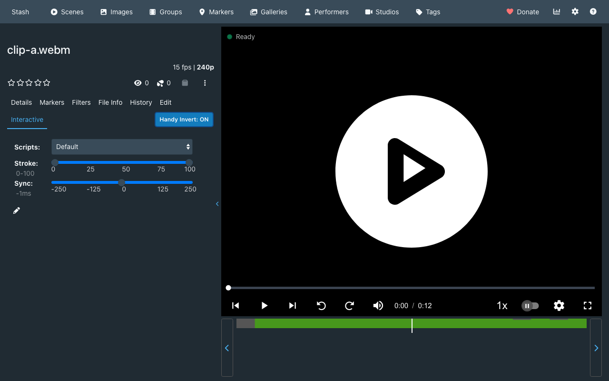
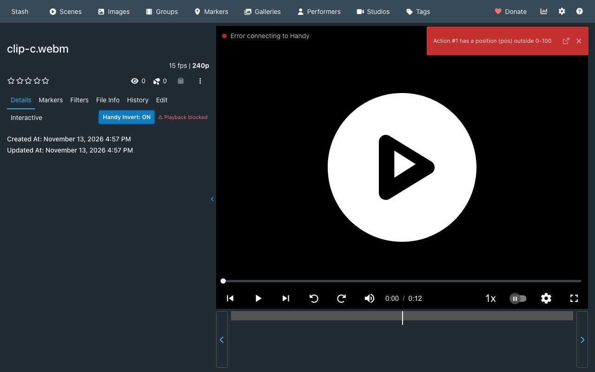

# Stash Global Handy Invert

A UI plugin for [Stash](https://github.com/stashapp/stash) v0.32.0 that **inverts the stroke direction of The Handy (L0) for every scene**, like FapTap's Invert switch (`pos -> 100 - pos`; timestamps `at` are never changed). Turn it on once and it stays on.

- It never changes your videos, funscripts or the Stash database. Only the data sent to the device is inverted.
- It works together with [StashInteractiveTools](https://github.com/xtc1337/StashInteractiveTools) (SIT): `Scripts` (Default/LOW/NORMAL/HIGHER), Stroke, Sync and Modifications keep working.
- The setting is **stored in Stash's `config.yml`**, so it survives reloads, scene changes and Stash restarts, and it is the same in every browser.



## What you install

| Folder | Contents |
|---|---|
| `StashGlobalInvert/` | This plugin: one JS, one CSS and one YAML file. No Python. |
| `StashInteractiveTools/` | **SIT with an extension API** (replaces your SIT 1.1.x). Optional, but needed to invert while SIT is installed. |

### Why SIT needs a small change

A standalone plugin cannot change the script SIT sends. This was verified in SIT's source:

1. SIT replaces `uploadScript` on Stash's interactive client with `Object.defineProperty` (`interactive-api-patcher.ts`). A wrapper registered through Stash's official hook (`interactiveClientProvider`) is therefore overwritten.
2. SIT's upload reads the script from its private state (`state.blobUrl`) instead of the path it is given (`enable-handy-tokens.ts`), so an inverted script passed from outside is ignored.
3. The CSV conversion and the upload are module-private. The only shared point is the global `fetch`, which this plugin deliberately does not hook.

So SIT gets only a **generic extension API**: a hook that runs right before the script becomes the CSV sent to the device. The invert itself lives in this plugin. The SIT change lives in the fork [royalark/StashInteractiveTools](https://github.com/royalark/StashInteractiveTools/tree/feat/extension-api) (branch `feat/extension-api`), is documented in its [`docs/extensions.md`](https://github.com/royalark/StashInteractiveTools/blob/feat/extension-api/docs/extensions.md), and is meant for an upstream pull request.

## Installation (Windows example)

1. Back up your current SIT plugin folder:

   ```powershell
   Copy-Item -Recurse "$env:USERPROFILE\.stash\plugins\StashInteractiveTools" "$env:USERPROFILE\.stash\StashInteractiveTools.backup"
   ```

2. Download both zips from the [latest release](https://github.com/royalark/stash-global-handy-invert/releases/latest) and extract them into your plugins folder (`%USERPROFILE%\.stash\plugins\`). Overwrite `StashInteractiveTools`; its existing `.scripts` and Python dependency folders can stay.

   ```text
   %USERPROFILE%\.stash\plugins\StashGlobalInvert\StashGlobalInvert.yml
   %USERPROFILE%\.stash\plugins\StashGlobalInvert\stash-global-invert.js
   %USERPROFILE%\.stash\plugins\StashGlobalInvert\stash-global-invert.css
   %USERPROFILE%\.stash\plugins\StashInteractiveTools\index.js   (build with the extension API)
   ```

3. In Stash: `Settings -> Plugins -> Reload plugins`, then hard-reload the browser (`Ctrl+Shift+R`).
4. Check that **Stash Global Handy Invert** is listed under `Installed Plugins`.

> **Note:** Updating SIT from Stash's plugin manager brings back a SIT without the extension API. While Invert is ON, this plugin then **blocks playback** and tells you why, instead of sending an un-inverted script. Reinstall the SIT build with the extension API, or turn Invert off.

## Usage

- Click the **`Handy Invert: ON/OFF` button in the tab bar of a scene page**. It is shown on interactive scenes only.
- Or use `Settings -> Plugins -> Stash Global Handy Invert -> Global Handy Invert`.
- **Changing it during playback:** the device is stopped and the video paused first. The script is then prepared again with the new setting. When the "applied - press play to resume" toast appears, press play. The direction never flips in the middle of a stroke.
- Hover the button to see whether the script currently prepared on the device is inverted or original.

## Behaviour

| Situation | Invert OFF | Invert ON |
|---|---|---|
| SIT (extension API) with Default/LOW/NORMAL/HIGHER | original | the selected script, after SIT's modifications, inverted **once** |
| Scene with a single script | original | inverted |
| Stash's built-in Handy client (no SIT) | original | inverted (`inverted`/`range` metadata handled the way Stash does, then inverted once) |
| SIT without the extension API | original (SIT unchanged) | **playback blocked** with a notice |
| Handy token scripts, ivdb scripts | original | **playback blocked** (content not visible, cannot be inverted) |
| Stash's "Use Stash hosted funscript" option (no SIT) | original | **playback blocked** (the server builds the CSV) |
| Corrupt script (NaN, outside 0-100, no actions) | existing SIT/Stash behaviour | **playback blocked**, naming the bad action (values are never clamped) |
| SIT Custom modifier containing `100 - pos` | that preset inverts | the two cancel out: a `⚠ Double invert` warning is shown |

"Playback blocked" means nothing is loaded onto the device, a stop command is sent, and `play` is ignored afterwards. A `⚠ Playback blocked` badge and an error toast appear. Stash's own status line then reads "Error connecting to Handy"; the toast states the actual reason.



## Where the setting is stored

Stash's plugin settings, in `config.yml`:

```yaml
plugins:
  settings:
    StashGlobalInvert:
      enabled: true
```

- It is stored on the server, so every browser and device sees the same value.
- The value is re-read from the server for every device upload. A change made in another browser applies from the next upload (opening a scene, changing scripts). The button in an already open tab may need a reload to update.
- If the setting cannot be read from the server and no cached value exists, the upload is refused rather than assuming OFF.

## Verification

| Kind | Result |
|---|---|
| Unit + integration (`npm test`) | 64 passed: pure transforms, settings, client wrapper, SIT transform, wiring with the real SIT fork source |
| SIT fork unit tests | 14 passed |
| End-to-end (real Stash v0.32.0 binary + real plugin builds + Chromium) | 18 passed, on both development and production builds |

The end-to-end tests assert on the CSV the device would download and on the `hssp/setup` call that loads it. They cover:

- OFF sends the original; one click ON sends it inverted with identical timestamps
- each of LOW/NORMAL/HIGHER/Default inverted
- persistence across reload, another browser profile and a Stash restart
- A -> scene list -> single-script B -> A
- rapid LOW -> NORMAL -> HIGHER switching: only the last choice is loaded
- zero uploads and zero plays for a corrupt script and for SIT without the extension API
- toggling during playback: stop, pause, prepare again
- Stash's built-in client path, and the hosted-funscript block
- removing the plugin restores the previous behaviour
- coexistence with SIT's Interactive tab

**Not verified:**

- **A real Handy device.** The Handy API and the handyfeeling CSV upload were replaced by local fakes; nothing was sent to external services.
- **SIT's Python backend.** Its `init` task (which lists alternative scripts) was faked; this work does not change it.
- **Windows.** Tests ran on macOS. The plugin is browser-only JavaScript, but this was not checked on Windows.

## First test with a real device

1. Set SIT's **Stroke range narrow** (for example 40-60) and start with a slow scene.
2. Play with Invert OFF to confirm the current direction.
3. Pause, click `Handy Invert`, wait for the "applied" toast, then play. The direction should be reversed.
4. Try other scenes and LOW/NORMAL/HIGHER, and check the setting after a reload.
5. If you previously saved a `Custom` invert preset, remove it (see the double invert warning).

## Rollback

1. Delete the `StashGlobalInvert` folder from your plugins folder.
2. To return to the original SIT, restore your backup of `StashInteractiveTools` or reinstall SIT from the plugin manager.
3. `Reload plugins`, then hard-reload the browser.

A leftover `StashGlobalInvert` entry in `config.yml` has no effect.

## Development

```bash
npm install
npm test          # vitest
npm run typecheck
npm run build     # -> dist/StashGlobalInvert/
npm run e2e       # Playwright against a real Stash binary, see e2e/README.md
```

`tests/integration.sit.test.ts` runs this plugin against the real SIT fork source. Clone [royalark/StashInteractiveTools](https://github.com/royalark/StashInteractiveTools/tree/feat/extension-api) (branch `feat/extension-api`, then `yarn install`) next to this repository, or set `SIT_SRC=/path/to/StashInteractiveTools/src`. Without it those tests are skipped.

| File | Role |
|---|---|
| `src/invert.ts` | Pure transforms (for SIT and for Stash's built-in client) |
| `src/client.ts` | `interactiveClientProvider` wrapper: built-in path invert, SIT patch detection, safety fuse |
| `src/sit.ts` | SIT extension API connection and output transform |
| `src/settings.ts` | Reading and writing the server-side setting |
| `src/ui.tsx` | Toggle button and toggle sequence |
| `e2e/` | End-to-end suite (real Stash, faked Handy API) |

## Out of scope

- Multi-axis invert (pitch/roll/twist ...). Only the L0 script sent to the Handy is inverted. If SIT's dropdown lists files such as `.pitch`, do not select them for the Handy.
- Sync offset and server time offset (for example 34 ms) are unrelated to inverting and are not touched.

## License

MIT
